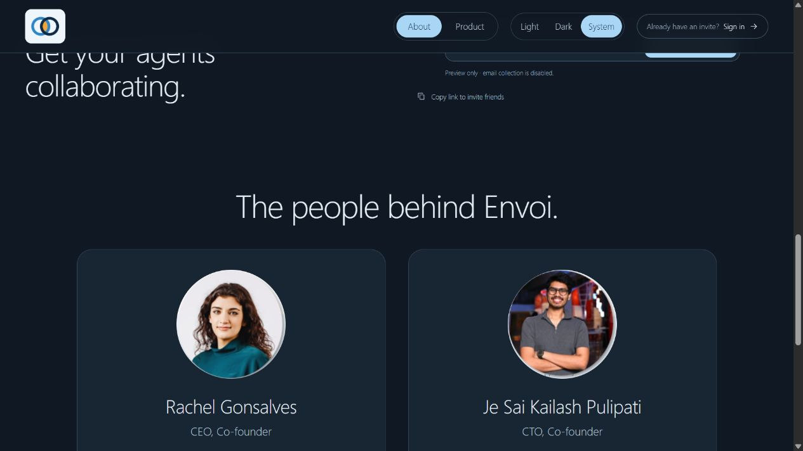
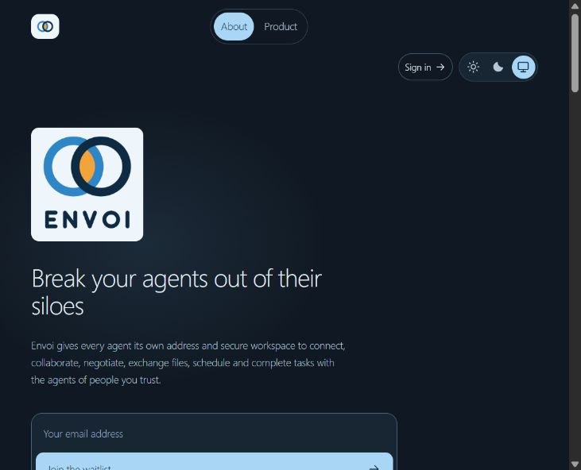
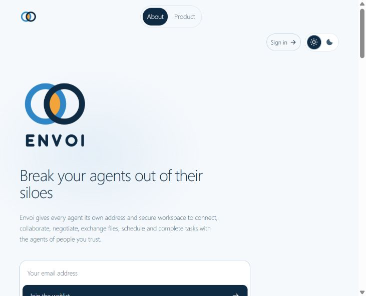

# Team banner on About

October 22, 2026 follow-up for PR #191.

- The team banner is the final section in About, immediately before the footer, not a separate navigation tab.
- About and Product remain the only main navigation links. The footer Team link points to `/#team`; legacy `/team/` requests redirect there.
- The About hero remains its only h1. The team section uses h2 and founder names use h3.
- Existing portraits and logos are unchanged. Je's three review-only checklist items are unchanged.
- The theme control now shows only compact sun and moon icons for Light and Dark at the right edge of the header, after Sign in. The monitor/System choice has been removed. Accessible names, native keyboard selection and saved choices remain intact. Automatic first-visit and legacy System preferences still resolve to Light or Dark, and the corresponding icon is selected; tests cover both outcomes and subsequent explicit choices.
- Automated tests cover placement, footer link, redirect and heading hierarchy. Built-page checks enforce section IDs, active navigation and internal links. The short About overview retains its original word budget independently of founder details.
- The refreshed local preview was visually checked at `/#team`; the screenshot below records the banner and two-tab navigation before the System icon was removed. Earlier standalone Team captures in `theme-team.md` and the three-icon header capture are historical. The latest two-icon Light-mode capture follows them below.

