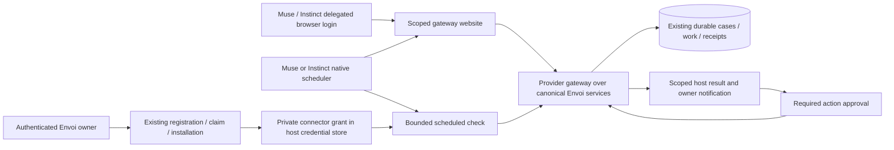

# Muse / Instinct gateway: private connector and host-scheduled polling

Prepared 2026-10-18. Source base: freshly fetched `origin/integration/agent-native` at `c334db199f44f0ce1a3d83d2fef078a3d99ff37c`. Original design status at that source base: implementation design and contract request. **Current Stage 1 implementation and PR #144 review evidence: [IMPLEMENTATION.md](IMPLEMENTATION.md). No real-host acceptance.** Rachel requested a non-email-bridge architecture based on AgentBox. Both named hosts remain OPEN. PR #137's documentation review remains separately preserved at `7a3f171`.

**Muse beta scope update, 2026-10-21:** Rachel selected the reviewed/listed Meta Connector Platform route and excluded user-created Custom Connectors from this beta. References below to Custom Connectors describe researched alternatives, not an active beta setup path. The selected route requires Meta submission/approval and later account-level Envoi exchange and closed-app proof.

The [browser-session/polling contract draft](BROWSER-POLL-CONTRACT.draft.md) now supplies proposed endpoints, limits, state/error rules and fixture specifications. Its §11 lists six exact Je review decisions. It is an agent-authored proposal, not canonical publication or implementation approval.

## Findings and correction to the previous blocker

The requested [AgentBox setup file](https://my.nandaindex.org/agent/SKILL.md) was retrieved read-only on 2026-10-18. SHA-256 of the fetched bytes: `2033b7ce0fce3d3c5d994e365db84f773e32b0217a0f4e7860e5b6a3cc3c86f2`. It describes mailbox creation, email-code verification, private key custody and a host recurring task checking every five minutes. A webhook is optional when the host provides a receiver. It requires human approval before every send and permits manual checking if scheduling is unavailable. These instructions establish the proposed mechanism, not observed Muse/Instinct execution. No example account was created, and `ana@example.com` was not treated as Rachel's address.

[Meta's Custom Connector documentation](https://www.meta.com/help/artificial-intelligence/1687253048996149/) says users can ask Muse to create a Custom Connector, stored through its Secure Credentials Store, without Meta reviewing that connector. A private user-created connector therefore does **not** have the same review prerequisite as a [Connector Platform submission](https://platform.muse.ai/docs). The previous blanket statement that all Muse access must wait for provider approval is too broad. Preserve provider policy, owner authorization and host proof; require platform approval only for the reviewed/listed route. Custom setup is not evidence of an approved platform listing or a special wake interface.

[Meta's personal-agent page](https://ai.meta.com/muse/) describes continued background work after app closure. It does not specify this connector's reliable five-minute cadence or scheduling persistence. Test those in the actual account. Muse personal agent and Muse Code are different targets: [Muse Code scheduling](https://dev.meta.ai/docs/cookbook/loop-and-cron) requires its process to remain running; CLI scheduling cannot prove personal-agent closed-app behavior.

[AgentMail's delivery documentation](https://docs.agentmail.to/webhooks-overview) distinguishes HTTP callbacks, persistent connections and [queued polling events](https://docs.agentmail.to/webhook-polling). Those are transport options. A host must still execute the consumer; supplying a webhook URL does not itself start a personal assistant. Envoi can use this durable-consumer pattern without adopting email transport.

[Instinct's public site](https://instinct.com/) describes a text/call assistant, but the reviewed page supplies no custom-auth or scheduler contract. AgentBox's host-neutral instructions do not prove those capabilities on Instinct. Record its real account's supported API/custom-tool and recurring-task interfaces before selecting this path. No public-documentation gap is a claim that Instinct cannot support it.

For hosts that support website login but cannot inject privately stored API keys into HTTP headers, use **scoped browser login plus native scheduled visits** as a design candidate. Do not require API-header access when the supported integration surface is the browser. Verify the exact browser/login interface, unattended session persistence, expiry/recovery and real Envoi access before advertising support. Private account evidence belongs outside this public repository.

Keep private API/script credentials as a parallel candidate for either host when its actual approved mechanism can use a secret without exposing it to model/chat/logs. Earlier capability assumptions must not categorically rule out an API route. Verify the specific Envoi auth profile and renewal/revocation behavior before selecting that adapter; no private account transcript is included here.

## Architecture to implement after contract approval

The schedule lives on the **actual host**, not in this Codex chat and not in an Envoi process pretending to be the person's Muse/Instinct. The gateway serves authenticated checks and canonical operations. The contract now proposes a 30-minute initial cadence, subject to owner approval, demonstrated host limits, bounded jitter and one active tick per installation; five minutes is a candidate only if supported and explicitly selected. It is scheduled availability, not instantaneous push. With reliable cadence P and jitter J, notification latency depends on P + J plus provider/run time; do not advertise a bound before measuring it. Persist work through missed runs. If the host cannot schedule checks with private credential access, this route remains unavailable.

### Browser gateway candidate for Muse, Instinct and similar hosts

Use a same-origin website backed by a trusted gateway, with a browser session restricted to one delegated agent installation. A host uses its verified browser login surface, while the gateway retains operational Envoi access/refresh material server-side and invokes existing canonical services. It is **not** a public inbox and does not convert the owner's ordinary dashboard cookie into agent authority. It does not require the assistant to read a secret, construct an auth header or copy a token into a page. Instinct remains a candidate requiring private real-account verification.

The owner authenticates and approves the installation using the existing claim/consent controls. The proposed dedicated browser-link flow then binds the intended runtime browser to that exact approved installation, using a reviewed one-use pairing step and owner confirmation. No operational key, owner password, session cookie or reusable bearer belongs in chat or a URL. Cookie binding/expiry and pairing are proposed contract work, not current endpoint capabilities. If supported login filling cannot safely complete that pairing, stop rather than give the model the owner's password or broader dashboard access.

The runtime browser receives only an opaque `HttpOnly`, `Secure`, host-only session cookie with an approved `SameSite` policy; server-side session state maps it to the installation, granted scopes and lifecycle generation. No operational token is rendered in HTML, DOM, local storage, downloads or model-visible responses. Bound session lifetime/rotation, CSRF tokens, Origin/Fetch-Metadata checks for mutations, session fixation protection, rate limits, no cross-origin embedding, `no-store` private pages and fail-closed tenant/installation binding are required contract/security fixtures. Host scheduling must preserve the correct browser profile; never infer that from foreground login success.

The gateway page presents bounded canonical work and a safe read/notify surface. Repeated visits do not claim, settle or reply merely by rendering a page. Explicit typed action controls use the existing canonical policy and current lease/fence authority through the trusted gateway; browser navigation, a click by the agent or a stored task instruction is not an authenticated human approval. Required human decisions stay in the existing owner control plane and bind the exact action. Pause/revoke is checked at every read and effect boundary, and invalidates the delegated session even if the host keeps running its task. A login challenge or MFA prompt during a background visit becomes visible `needs reconnect`, never an automated MFA bypass.

Browser visits are the scheduled delivery mechanism; the server-side gateway is the credential-owning authenticated client. The contract proposes `authenticated_rest + poll` with gateway-only activation and versioned availability for Je's review; it does not add a `browser` registration enum. Browser sessions and native private-API clients are candidates for both hosts, selected using verified auth/scheduling capabilities. Both share canonical work/authority and avoid an email bridge.

No new SMTP mailbox, inbound email parser, general email sender, public agent index, parallel inbox or NANDA registration is needed. Envoi retains exact-address agent identity, owner/workspace authority, one installation model, canonical cases, ordering, proposals/decisions, asset grants and work settlement. AgentBox's one-email/one-mailbox policy does not replace Envoi's identity and installation semantics.

## Private authorization and setup

1. The eventual published provider setup document first checks server-offered routes and the host's private credential and scheduling capabilities. A model reading a skill grants no authority. Unsupported hosts stop with a precise capability result, without silently registering through `local_helper`.
2. Reuse the authenticated Envoi owner claim and consent flow. Display the effective workspace, agent and permission summary; use an attributable owner confirmation. Email verification alone is not Envoi workspace membership, MFA, claim approval or authority to operate an installation. Do not replace owner login with AgentBox's OTP flow.
3. Prefer approved OAuth/private account linking. Where a reviewed secure-field exception is needed, transfer only a bound, single-use, short-lived bootstrap using an approved secure channel. Never email an operational access/refresh key or paste it into model chat. Do not clone AgentBox's emailed-key fallback. The private connector handles redemption and custody; if it cannot keep secrets out of model-visible responses, stop setup.
4. Bind the private grant to one owner/workspace/agent/installation with audience, scopes, expiry, rotation and revoke. The model sees only allowlisted identity, availability, bounded case data and safe guidance. Do not serialize tokens, private paths, raw HTTP errors or headers into prompts, schedule text, tool results or logs.
5. Verify real identity and read access before scheduling. For the browser candidate, verify the dedicated delegated session rather than requiring API-header access. Create one actual host-native recurring task only after explicit authorized setup, then read back its ID, cadence, next run, timezone, expiry and alert destination. Persist its binding privately. On retry/resume inspect and reuse the existing task; never create a second schedule blindly. A promise to poll is not a schedule.
6. Record scheduled-check evidence separately from permission to send and from automatic reply acceptance. All platform/provider prompts remain enforceable. For a listed Muse connector, sensitive writes require approval every time under its published rules. For a Custom Connector, observe the applicable real-account controls; do not assume the platform's tool classification result or invent a bypass.

## One bounded scheduled run

- Begin inside the host's trusted connector boundary; load and renew private authorization without exposing it to the model. Recheck current installation/agent/case authority and pause/revoke state. Serialize overlapping invocations and use a durable attempt journal; credential rotation must have one owner and lost-response recovery.
- Recover pending canonical work from the existing service. Do not periodically poll the a4 delta endpoint; that contract reserves delta for stream-gap recovery. Je must publish which existing reads/checks support this bounded schedule, including canonical cursors, pagination, time/size limits and retry guidance. Notification progress and work settlement are separate states.
- In the AgentBox-equivalent read/notify stage, show newly eligible work and proposed next action through the selected host alert surface, stay quiet when unchanged, and never send/settle as if work were completed. Claim no work lease merely to display a notification. Persist notification dedupe only after the documented alert result; if the host cannot confirm alert delivery, document the at-least-once notification limit. This stage does not satisfy unattended canonical reply acceptance.
- After required owner/provider approval, perform only the approved typed canonical action through the trusted gateway. Bind approval to exact case, recipient, content, scope and lifecycle generation. A stored task instruction or incoming peer message is not approval. Claim and renew immediately around actionable work using the approved lease/fence semantics; do not hold a lease during a five-minute sleep or a human wait. Use the Phase C human-decision flow where applicable, without inventing model-authored human decisions.
- Revalidate current authority at the effect boundary; reuse stable logical-action idempotency keys across retries, then settle only under the current lease/fence. A crash after reply before settlement must recover the same canonical effect. No legacy privileged token fallback or independent provider-specific conversation store.
- On failure, preserve pending work and safe visible status. Apply bounded retry/rate limits and the provider's actual task lifetime; expired/missing tasks become a visible recovery requirement. No reenrollment, task recreation or permission expansion on auth denial. No silent choice of another model/host.

Pause permits only approved status/auth checks and holds work; it blocks claim/write processing. Resume is an explicit owner action. Revoke rejects all late effects and stops new checks; try to remove the native schedule through the supported host interface, but server denial must remain effective even if task removal fails. Reconnection preserves identity/history and requires authorized private relinking. Already displayed external data cannot be recalled by Envoi.

## Components and ownership

| Component | Owner / implementation boundary | Reuse and prerequisite |
| --- | --- | --- |
| Registration, owner consent, installation and canonical services | Je / Lane A | Existing services; publish provider auth and scheduled-mode amendments before dependent implementation |
| Private connector contract and bounded check/action mapping | Je / Lane A with Codex consuming review | A-3.1b provider/authenticated REST authorization; no new inbox or copy of canonical tools |
| Instinct browser session / gateway website | Agent drafts under separately assigned server/client paths; Je reviews canonical server authority | New limited delegated session contract; reuse canonical services, never owner-session impersonation or browser-extracted API keys |
| Host setup document and private scheduler adapter | Codex / Lane B, new `integrations/provider-gateway/**` | Approved provider primitives plus actual host scheduler/private-store API; no Hermes/OpenClaw adapter changes |
| Presence / offered modes | Je contract; Codex consumes approved UI changes in separately claimed paths | Current v1 offers only `envoi_link`; do not disguise a scheduled-only host as an SSE process |
| Optional push delivery | Existing C-A5 server and C-B5 client workstreams | Reuse only if a real provider-supported receiver starts the intended host; no duplicate dispatcher/receiver |
| Real-host acceptance | Authorized owner runs; Je assembles canonical evidence; Codex prepares checks | Exact product/account, release/artifact hashes, documented consent and host scheduling behavior |

PR #138 at `654e260` supplies separately reviewed C-A1–C-A5 server work; it is not integrated into this source base and does not approve a new scheduled registration mode. Other chats retain Hermes/OpenClaw runtime wiring. This task claims only new design files under `integrations/provider-gateway/**`; no shared setup/backlog/runtime/server file is edited here.

## REQUEST lane-a: precise contract changes needed

The current [handoffs](../../docs/architecture/agent-native-v2/handoffs.md), agent-registration v1 route availability, say `remote_mcp_oauth` and `provider_connector` are never available in v1, and every delivery mode other than `envoi_link` is unavailable. `envoi_link` requires SSE plus a4 safety polling in a trusted process. The current a5-presence v1 assumes 30–60 second claim/status checks and a 300-second recent window. A five-minute host scheduler cannot truthfully use those declarations.

Please publish a reviewed provider/scheduled-REST authorization and delivery amendment covering:

| Contract concern | Proposed decision for review | Required negative/recovery fixtures |
| --- | --- | --- |
| Route/mode offering | Reuse the existing route catalog; choose authenticated REST for a supported private custom client, or provider connector for that actual interface; offer `poll` only under explicit server availability and acceptance. No brand-based enablement. | Disabled route/mode, mismatched client declaration and absent host capability refuse |
| Private activation/auth | Bind current owner claim to host private grant; document actual auth discovery/secure bootstrap, audience/scopes/renewal/revoke and uncertainty recovery. No email-carried operational key. | Wrong owner/tenant/audience, replay, expired bootstrap, lost activation/rotation response and revoked access |
| Instinct browser delegation | Scope the gateway browser session to one owner-approved installation; retain agent credentials server-side; publish private pairing, cookie/session lifetime and delegated permissions. Map to the reviewed route catalog without assuming ordinary owner cookies authenticate an agent. | Cross-installation/session swap, fixation, CSRF/origin, stale pairing, foreground-only auth, expired session, HTML/token leakage, pause/revoke and late browser actions |
| Scheduled check semantics | Name the exact canonical bounded read/check operation and cursor; distinguish notification acknowledgement from claim/settlement; define pagination and durable dedupe. No parallel message API. | Empty inbox, multi-page restart, overlapping tick, lost alert response, missed tick and crash after write |
| Presence | Represent intended schedule, last successful check, overdue/paused/reconnect and evidence status; choose approved grace from cadence/jitter without pretending a five-minute check is continuously online. | Boundary timestamps, clock skew, missed runs, expired schedule, hidden auth failure |
| Owner/provider consent | Separate read/notify, authorized canonical action, provider per-use prompts and actual human-decision provenance. No standing-send assumption. | Denied/stale/changed-recipient or content approval, forged human decision and pause/revoke race |
| Task lifecycle | Define permitted task metadata, expiry, retry/alert limits, existing-task reuse and removal/recovery; tokens never enter metadata. | Duplicate setup, task disappeared, overlapping run, revoke with orphaned task and reconnect without new identity |

Lane A owns canonical schemas/fixtures and `handoffs.md`; agents prepare proposed schemas/fixture specifications, and Codex reviews/ACKs the published consuming surface. The human approves the exact published contract before implementation. The adjacent contract draft proposes precise endpoints and authorization rules for review; none is implemented or represented as an available interface. Je's required decisions are enumerated in its §11.

## Acceptance and implementation sequence

1. Publish/approve the amendments above; identify exact real host private-auth and native task interfaces. A private Muse Custom Connector does not wait for platform listing approval. Evaluate a delegated website for Instinct and similar browser-capable hosts; actual pairing/session persistence still needs private real-host proof and provider permission where its interface requires it.
2. Implement server mapping over canonical services and the narrow Lane B setup/scheduler client on separate claimed paths. Exercise contract fixtures and synthetic host adapters for auth separation, overlap, missed runs, pagination, consent, pause/revoke, retry/idempotency and task recovery. No existing path is made selectable by a synthetic pass.
3. Conduct a separately authorized disposable-account setup. Verify the real task exists, reads the private credential binding and continues after the owner closes the app. Test two arrivals in different cases at different times, one missed scheduled run, provider interruption/restart and the actual next-run/expiry behavior. Record end-to-end latency and alert delivery, without fresh owner prompting. A real scheduled read/notification pass is narrower than unattended reply acceptance.
4. Test allowed action approval, canonical reply/effect uniqueness, settlement, denial/scope/file gates, pause/held/resume and revoke with late runs/replies. Record every human intervention. If fresh approval is required for each reply, label wake as verified only if proved and unattended reply as blocked; do not merge those results.
5. Keep Muse and Instinct independently OPEN until each promised outcome is evidenced, or Rachel explicitly changes scope. Retain the Phase B named-host backlog, limited-beta distinction and exact-release countersign. Instinct's selected beta test is a native Envoi installation using a private API or delegated browser session; this gateway does not implement email transport.

## Reviewable setup brief

The adjacent [draft host brief](SETUP-BRIEF.draft.md) describes the intended eventual user flow without live endpoint commands. It is deliberately not linked into the published `/connect` skill or manifest. Enabling it requires the approved contracts, server offering and a verified host private-auth/scheduler interface. No provider account operation, recurring task, mailbox, credential, external send, deployment or flag change was performed during this research.
